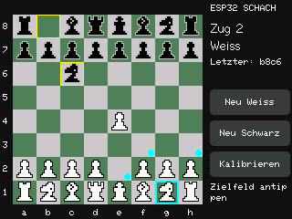

# ESP32-Schachcomputer

**[Firmware im Browser installieren](https://basti0772.github.io/ESP32-Schachcomputer/)**

Eigenständiger Schachcomputer für einen klassischen **ESP32-WROOM-32** mit
**ILI9341-Display und resistivem SPI-Touch (XPT2046-kompatibel)**.
Bedienung wahlweise per Touch oder seriell mit 115200 Baud.

## Display



Echter Screenshot (320 × 240 Pixel), am 13.10.2026 direkt aus dem
ILI9341-Displayspeicher über den seriellen Port ausgelesen. Die Stellung zeigt
1. e4 Sc6 mit ausgewähltem Springer auf g1 und markierten legalen Zielfeldern.
Für die Aufnahme wurde vorübergehend ein Diagnosebefehl ergänzt und die
Figur über simulierte Touch-Koordinaten ausgewählt. Danach wurde die normale,
hier veröffentlichte Firmware wieder installiert.

## Funktionen

- Schachengine mit Alpha-Beta-Suche, maximal Tiefe 4 und etwa 1,8 Sekunden pro Zug
- Legale Züge, Rochade, en passant, vier Bauernumwandlungen, Matt und Patt
- Touch: Startfigur und Zielfeld wählen; legale Ziele werden markiert
- Neue Partie als Weiß oder Schwarz, Auswahl der Umwandlungsfigur
- Vierpunkt-Touch-Kalibrierung mit Speicherung im NVS
- Querformat 320 × 240, um 90° nach links gedreht
- Serielle Befehle und Diagnosefunktionen auch während der Kalibrierung

Eine gemessene Elo-Zahl liegt noch nicht vor. Die Partie wird bei Neustart
zurückgesetzt; die Touch-Kalibrierung bleibt gespeichert. Wiederholung und
50-Züge-Regel werden automatisch als Remis gewertet.

## Browser Installation

Installer: **https://basti0772.github.io/ESP32-Schachcomputer/**

Unterstützt wird der klassische **ESP32-WROOM-32 / ESP32 Dev Module mit
4 MB Flash**, ILI9341 und der unten verlinkten Touch-Verkabelung. Keine S2-,
S3- oder C3-Variante. Benötigt werden ein USB-Datenkabel, ein Desktop-Browser
mit Web Serial (Chrome oder Edge empfohlen), Internetzugang und gegebenenfalls
der USB-UART-Treiber des Boards. Die Seite muss über HTTPS geöffnet werden.

1. ESP32 per USB anschließen und serielle Monitore schließen.
2. Installer öffnen und auf **Install** klicken.
3. Den seriellen Port des ESP32 auswählen und die Installation bestätigen.
4. Flash-Vorgang abwarten; anschließend am Display die vier Kreuze kalibrieren.

**Die Browser-Installation ersetzt die Firmware und löscht gespeicherte Daten
einschließlich Touch-Kalibrierung.** Auch die zusammengeführte BIN enthält
Füllbytes im NVS-Bereich. Für ein Update mit Erhalt der Kalibrierung den
bisherigen PowerShell-Flasher mit einzelnen BIN-Dateien verwenden.
Bei Verbindungsproblemen BOOT beim Verbindungsaufbau gedrückt halten.

### GitHub Pages einmalig aktivieren

Im Repository: **Settings → Pages → Build and deployment → Source:
Deploy from a branch → Branch: main → Folder: /docs → Save**.
Nach erfolgreicher Pages-Bereitstellung ist die oben genannte URL erreichbar.
Diese Repository-Einstellung kann nicht allein durch Dateien aktiviert werden.

### Web-Firmware selbst bauen

Arduino CLI im PATH, ESP32-Core **3.3.12**, TFT_eSPI **2.5.43** und
Windows PowerShell 5.1 oder PowerShell 7 installieren. Im Repository:

```powershell
powershell -ExecutionPolicy Bypass -File .\tools\Build-Web-Firmware.ps1
powershell -ExecutionPolicy Bypass -File .\tools\Test-Web-Firmware.ps1
```

Das Skript kompiliert vollständig mit `esp32:esp32:esp32` und bindet die
mitgelieferte Displaykonfiguration für diesen Build ein. Es verändert keine
installierte Bibliothekskonfiguration. Die Eingabedateien und Flash-Adressen
werden aus dem vollständig expandierten Arduino-Merge-Rezept gelesen.
Das passende esptool erzeugt mit explizitem Zieloffset 0 und den Buildwerten
für Flash-Modus, Frequenz und Größe eine zusammengeführte BIN.

Ergebnisse: `firmware/ESP32-Schachcomputer.bin`, `firmware/build-info.json`,
identische Kopien unter `docs/firmware/` und `docs/manifest.json`.
Die Kopie unter `docs/` ist notwendig: Bei Pages aus `/docs` ist
`../firmware/` außerhalb der veröffentlichten Seite und funktioniert nicht.
Die Version stammt zentral aus dem bestehenden Startbanner
`ESP32 CHESS 2.0` in `ESP32ChessTouch/ESP32ChessTouch.ino`; die Webseite liest
sie aus dem generierten Manifest. Zum Veröffentlichen neuer Firmware immer
beide Firmware-Ordner und das Manifest gemeinsam committen.

Der Workflow `Build web firmware` prüft den eingecheckten Installer, baut
bei Push auf `main` sowie bei Pull Requests und stellt das neue Ergebnis
als Actions-Artefakt bereit. Er ändert keine veröffentlichten Dateien.
Der Installer verwendet ausschließlich die dauerhaft eingecheckte BIN,
keine temporäre Artifact-URL. Rohdaten zu Offsets, Größe und SHA256 stehen
in `firmware/build-info.json`.

Lokale Vorschau (optional, Python erforderlich):

```powershell
python -m http.server 8080 --bind 127.0.0.1 --directory docs
```

Dann `http://localhost:8080` öffnen. Manueller Build des Arduino-Sketches
und Flashen ohne Browser bleiben wie nachfolgend beschrieben möglich.

Technische Referenzen: [ESP Web Tools](https://esphome.github.io/esp-web-tools/)
und [GitHub Pages veröffentlichen](https://docs.github.com/en/pages/getting-started-with-github-pages/configuring-a-publishing-source-for-your-github-pages-site).

## Schnellstart: fertige Firmware flashen

Repository über **Code → Download ZIP** herunterladen und vollständig entpacken.
Auf Windows benötigt der Flasher PowerShell 5.1 oder neuer sowie **esptool 5.x**
(getestet 5.3.1), etwa aus dem ESP32-Boardpaket der Arduino IDE.

Im Repository-Ordner:

```powershell
powershell -ExecutionPolicy Bypass -File .\ESP32ChessTouch-Flash\Flash-ESP32.ps1 -CheckOnly
powershell -ExecutionPolicy Bypass -File .\ESP32ChessTouch-Flash\Flash-ESP32.ps1
```

Der Port wird automatisch erkannt. Optional `-Port COM3` oder
`-EsptoolPath "C:\Tools\esptool.exe"` angeben. Bei Übertragungsproblemen hilft
`-Baud 115200`. Andere serielle Programme vor dem Flashen schließen.

Das mitgelieferte Anwendungs-Binary wurde am 12.10.2026 aus den unveränderten
Touch-Schachquellen neu gebaut, mit neutralisierten Compiler-Diagnosepfaden.
Bootloader und Partitionen stammen vom zuvor erfolgreich geflashten Stand.
Das neu gebaute Binary wurde am 13.10.2026 auf den ESP32 geflasht und seriell
geprüft: alle vier Selbsttests bestanden, die Touch-Kalibrierung blieb aktiv. Vor dem Upload werden SHA256-Prüfsummen geprüft.
Die NVS-Kalibrierung des bisherigen Partitionslayouts wird nicht gelöscht.

[Ausführliche Flash-Anleitung](ESP32ChessTouch-Flash/README.md)

## Arduino-Projekt selbst bauen

`ESP32ChessTouch/ESP32ChessTouch.ino` öffnen. Benötigt werden:

- ESP32-Boardpaket von Espressif Systems **3.3.12**
- TFT_eSPI von Bodmer **2.5.43**
- Board: **ESP32 Dev Module**, FQBN `esp32:esp32:esp32`

Die Datei `ESP32ChessTouch/config/User_Setup.h` in der TFT_eSPI-Bibliothek als
`User_Setup.h` verwenden; eine vorhandene Konfiguration vorher sichern.
Die Einstellung gilt bibliotheksweit. Details stehen in der Projektanleitung.

```powershell
arduino-cli compile --fqbn esp32:esp32:esp32 .\ESP32ChessTouch
powershell -ExecutionPolicy Bypass -File .\ESP32ChessTouch\Build-And-Flash.ps1
```

[Verkabelung, Touch-Kalibrierung und Bedienung](ESP32ChessTouch/README.md)

## Terminal

```powershell
powershell -ExecutionPolicy Bypass -File .\ESP32ChessTouch\Play-Chess.ps1
```

Beispiele: `new`, `new black`, `e2e4`, `e7e8q`, `board`, `legal`, `help`.
Im seriellen Monitor: 115200 Baud, 8N1, LF oder CRLF.

## Tests und Stand der Prüfung

Die Firmware wurde auf dem ESP32 kompiliert, geflasht und seriell geprüft.
Vier Referenz-Perft-Tests, die Touch-Bedienlogik über simulierte Koordinaten,
alle vier Umwandlungen und automatische Engine-Antworten bestanden.
Eine vollständige Partie gegen einen einfachen PC-Testgegner endete nach
29 Zügen mit einem Sieg des ESP32; das ist keine Elo-Messung.
Die gespeicherte Touch-Kalibrierung wurde nach erneutem Flashen als aktiv gemeldet.
Das direkt ausgelesene Displaybild wurde am 13.10.2026 visuell geprüft
(siehe Screenshot oben). Die physische Touch-Genauigkeit wurde dabei nicht neu geprüft.

- [Testbeschreibung](ESP32ChessTouch/TESTS.md)
- [Testpartie](test-results/test-game.pgn)
- [Touch-Protokoll](test-results/touch-test-results.json)

Optionale PC-Tests benötigen Python und lokal installierte Testabhängigkeiten:

```powershell
python -m pip install --target .test-deps python-chess pyserial
python .\Serial-Chess.py board selftest
python .\Test-TouchChess.py
```

Die Hardwaretests starten neue Partien und verändern den Spielzustand auf dem
angeschlossenen ESP32. Die eigentliche Firmware benötigt kein Python.

## Ordner

- `ESP32ChessTouch/`: vollständiges Arduino-Projekt und Windows-Hilfsskripte
- `ESP32ChessTouch-Flash/`: fertige Firmware, Prüfsummen und Flash-Skript
- `test-results/`: vorhandene Testergebnisse und Beispielpartie
- `docs/`: direkt vom Display ausgelesener Screenshot

Fremdbibliotheken werden über Arduino beziehungsweise pip installiert und sind
nicht als lokale Entwicklungsumgebung mitkopiert. Siehe [Drittanbieterhinweise](THIRD_PARTY.md).

